<table>
<tr>
<td width="38%" align="center">
  
</td>
<td width="62%">

## Halo! I'm Gofur 👋

Builder behind **noHype Labs** from Jakarta, Indonesia. I'm not following the hype, I'm the hype.
I build production-ready tools that actually ship: business apps (POS, inspection, logistics),
learning platforms, and trading & on-chain AI agents on Solana. Daily driver: CachyOS + Hyprland,
and a green-on-Tokyo-Night terminal.

### Languages, Database, Tools

<a href="https://skillicons.dev">
  
</a>

<br /><br />



</td>
</tr>
</table>

### what I'm building

<table>
<tr>
<td width="50%">

#### [SignalFlow Agent](https://github.com/nohypelabs/signalflow-agent)
> AI-powered signal-to-execution trading agent

- Hyperliquid-style trading UI, 34 SoDEX symbols
- Real-time charts, orderbook, position management
- **Stack:** Next.js 16 · React 19 · Tailwind v4 · TypeScript

</td>
<td width="50%">

#### [Bahann POS](https://github.com/nohypelabs/bahann-pos)
> Point of Sale for retail businesses

- Inventory management, sales tracking, reporting
- Built for small shops that need it to just work
- **Stack:** Next.js · TypeScript

</td>
</tr>
</table>

<div align="center">

[](https://abdulgofur-builder.vercel.app)
[](https://x.com/nohypelabs)


<a href="https://github.com/nohypelabs">
  
</a>

```
no hype. just code.
```

</div>
